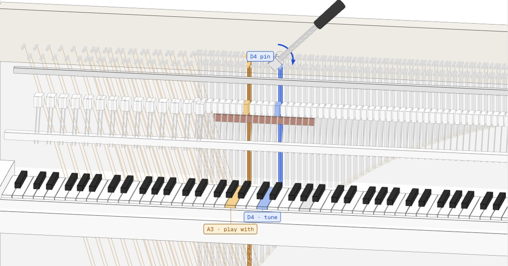

# Piano tuning guide

An interactive, phone-first 3D guide to tuning an **upright piano by ear** in equal
temperament at **A4 = 440 Hz**. It walks through the classic technician method in 27 short
steps: set A4, build the middle octave (F3 to F4) with slow-wobbling 4ths and 5ths, check it
with the fast 3rds, tune the unisons, then copy it outward by octaves.

Plain static files: no build step, no server code, no tracking. Works offline after the
first visit.



## What is in it

- **Steps.** 27 numbered steps. Each lights up the keys to play (blue = the note you tune,
  amber = the note you play with it), the strings and the pin on a simplified 3D upright,
  with the tuning lever seated on the pin and a small clockwise turn animation. Each tuning
  step gives the interval, the target beat rate (with "wide" or "narrow"), what to listen
  for, where the beat lives (the coincident partial) and the checks that become possible.
- **Keys.** Tap any of the 88 keys: frequency, which step tunes it, the note it is tuned
  from, every check that involves it with the beat rate of each, and its unisons.
- **Hear it.** Web Audio demos: an interval played pure and then as equal temperament
  tunes it, so you hear the beats; a pulsing light follows the computed beat rate. Sound
  only plays after a tap.
- **Tuner.** Asks for the microphone only when you tap Start. Guided mode aims at the
  current step's note (green when within 1.5 cents for half a second, an arrow says which
  way to turn); Raw mode is a plain chromatic tuner. A compact bar keeps the reading in
  view while you move between steps. Stop ends every mic track.
- **Learn.** What a beat is, why not every interval can be pure, the method in one
  paragraph, a glossary, the beat-rate table "for the curious", and the sources.

## How it works

| File | What it does |
|---|---|
| `index.html` | The page shell, import map and link-preview tags |
| `css/app.css` | All styles (phone first; desktop from 900 px). The look is described in `DESIGN.md` |
| `js/data.js` | **The single source of truth.** Notes, frequencies, beat rates, the 27 steps, every check, the glossary and the sources. The steps, the Keys tab, the table and the demos all read from it, so they cannot disagree. No DOM: it also runs under Node |
| `js/scene.js` | The three.js diagram: keyboard, hammers, strings, pins, pin block, lever, felt strip |
| `js/audio.js` | Web Audio tones (harmonic partials) for the demos and the 440 Hz reference |
| `js/tuner.js` | Mic tuner: YIN finds the note, then a windowed spectral peak measures the fundamental exactly |
| `js/app.js` | Tabs, cards, labels, gestures, sheets and the tuner UI |
| `sw.js`, `manifest.webmanifest`, `icons/` | Offline cache and home-screen install |
| `vendor/three/` | three.js r186 (MIT), so nothing loads from a CDN |
| `fonts/` | Geist and Geist Mono (SIL OFL 1.1) |
| `dev/` | Tests and helper scripts (not needed to host the site) |

**Beat rates** are computed, not typed. Each note is `440 × 2^((n − 69)/12)` Hz. The beat of
an interval is the difference between the two partials that nearly coincide: 3rd partial of
the lower note against the 2nd of the upper for a 5th, 4th against 3rd for a 4th, 5th against
4th for a major 3rd, 5th against 3rd for a major 6th, 2nd against 1st for an octave.

**The order** is William Braid White's F-to-F circle of 4ths and 5ths (1917), run the other
way round and started from A440: A4 (fork), A3 (octave), D4, G3, C4, F3, A#3, D#4, G#3, C#4,
F#3, B3, E4 (closing the circle against A3 and A4), F4 (octave). Every 4th goes up and every
5th goes down, so each new note comes up through the still point and stops a hair sharp of it.

### Beat rates for the temperament octave (ideal strings, A4 = 440 Hz, beats per second)

| Note | Hz | 4th up (wide) | 5th up (narrow) | M3 up (wide) | M6 up (wide) |
|---|---:|---:|---:|---:|---:|
| F3 | 174.61 | 0.79 | 0.59 | 6.93 | 7.92 |
| F#3 | 185.00 | 0.84 | 0.63 | 7.34 | 8.39 |
| G3 | 196.00 | 0.89 | 0.66 | 7.78 | 8.89 |
| G#3 | 207.65 | 0.94 | 0.70 | 8.24 | 9.42 |
| A3 | 220.00 | 0.99 | 0.74 | 8.73 | 9.98 |
| A#3 | 233.08 | 1.05 | 0.79 | 9.25 | 10.58 |
| B3 | 246.94 | 1.12 | 0.84 | 9.80 | 11.21 |
| C4 | 261.63 | 1.18 | 0.89 | 10.38 | 11.87 |
| C#4 | 277.18 | 1.25 | 0.94 | 11.00 | 12.58 |
| D4 | 293.66 | 1.33 | 0.99 | 11.65 | 13.33 |
| D#4 | 311.13 | 1.41 | 1.05 | 12.35 | 14.12 |
| E4 | 329.63 | 1.49 | 1.12 | 13.08 | 14.96 |
| F4 | 349.23 | 1.58 | 1.18 | 13.86 | 15.85 |

Cross-checked against US Patent 8,569,607 Fig. 4 (A440, F3 to F4) and Wikipedia's equal
temperament beat table (C4 to C5): 15 published values agree to within 0.003 beats per second
(`node dev/test_data.mjs`).

**These rates are approximate on a real piano.** Piano wire is stiff (inharmonicity), so its
partials run sharp, octaves that sound clean end up slightly wide (stretch, the Railsback
curve) and the real beat rates drift from the ideal ones, more so on small uprights.
Technicians treat the numbers as a guide and the smooth rise of the 3rds as the real test.

## Run it locally

Serve the folder with any static server (the mic needs `https` or `localhost`):

```bash
uv run python -m http.server 8791 --bind 127.0.0.1
# then open http://127.0.0.1:8791/
```

Deep links: `#step-9`, `#note-As3` (`s` = sharp), `#tuner`, `#learn`. Add `&still` to
freeze animations for screenshots.

## Host it

It is a static folder: copy the repo root (or just `index.html`, `sw.js`,
`manifest.webmanifest`, `og.jpg`, `css/`, `js/`, `vendor/`, `fonts/`, `icons/`) to any
static host: GitHub Pages (Settings, Pages, deploy from the main branch, root), Netlify,
Cloudflare Pages, S3, or a plain web server. It must be served over HTTPS for the microphone.
All paths are relative, so a sub-folder such as `/piano-tuning-guide/` works.

Optional: `dev/dist.py OUTDIR --base https://your.host/path/` writes a copy with content-hash
cache stamps on every asset (so returning visitors get updates at once) and absolute
`og:image` / `og:url` tags for link previews. Without it, bump the `?v=1` stamps in
`index.html` and `sw.js` by hand when you change a file.

## Tests

```bash
node dev/test_data.mjs                      # data model, beat rates, published cross-check, pitch detector
uv run python -m http.server 8791 --bind 127.0.0.1 &
dev/test_e2e.py http://127.0.0.1:8791/       # real Chrome via Playwright: every tab, no mic on load,
                                            # tuner targets and lock, 88 keys, swipes, audio beat rates,
                                            # offline, no-WebGL fallback, no sideways scrolling
dev/shots.py http://127.0.0.1:8791/ /tmp/shots --hash step-9 --size 390x844 --size 1440x900
```

`test_e2e.py` wraps `navigator.mediaDevices` to prove the page never touches the microphone
before the Start tap, and renders the demo audio offline to measure that the "pure" phase is
still and the "tempered" phase beats at the rate on screen.

## Known limits

- The 3D piano is a diagram, not a scan: on a real upright the strings do not sit exactly
  above their keys. Follow the string from the hammer to its pin.
- String counts (10 single, 18 double, 60 triple) are typical, not universal.
- A phone tuner gets each note close; the tempered 4ths, 5ths and unisons are finished by ear.
  Below about A1 a phone microphone can read an octave high.
- Not a substitute for a technician when a piano is far flat, has loose pins or rusty strings.

## Sources

The page lists all of them with links (Learn, Sources). The main ones:
Piano Technicians Guild (Beginner FAQs, Basic Tuning Skills Checklist, RPT exam guide, Fred
Sturm's "Tuning Hammer Technique"); Indiana University Piano Technology (Equal Temperament,
exercises, Pythagorean comma); William Braid White, *Modern Piano Tuning and Allied Arts*
(1917); Howard Piano Industries "How to Tune a Piano" parts 4 to 6; Chuan C. Chang,
*Fundamentals of Piano Practice* ch. 2; Mark Cerisano RPT, "Aural Stretch Using Beat Speed
Windows" (PTJ 2017); Bill Bremmer RPT on contiguous 3rds; Wikipedia (Piano tuning,
Pythagorean comma, Diesis, Stretched tuning, Piano acoustics); UNSW Music Acoustics; Yamaha;
PianoMeter.

## License

MIT (see `LICENSE`). three.js is MIT (`vendor/three/LICENSE`); Geist and Geist Mono are under
the SIL Open Font License 1.1 (`fonts/OFL.txt`).
